<div align="center">

# 0010 · Digital Pattern Detector

### A gate-level, clock-synchronous serial sequence detector

**4-bit LFSR → parallel-load / serial-out register → Mealy FSM → detection indicator**

`IE3004 Digital System Design` · `Proteus 8` · `74LS TTL logic` · `Group 10`

</div>

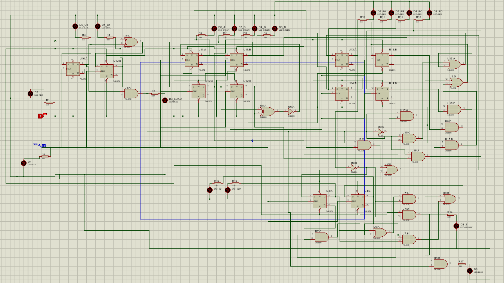

> **Project status:** Original Proteus design and group report are preserved in this repository. The engineering notes explain the report's FSM transition table and identify discrepancies that should be checked in Proteus.

## At a glance

| Item | Detail |
|---|---|
| Target sequence | `0010` in a serial bit stream |
| Architecture | 4-bit pseudo-random source, 4-bit PISO, four-state Mealy detector |
| State memory | Two D flip-flops, encoding `S0=00`, `S1=01`, `S2=10`, `S3=11` |
| Logic family | 74LS74, 74LS04, 74LS08, 74LS32, 74LS86 |
| Design environment | Proteus Design Suite 8; PCB layouts described in the report were made in EasyEDA |
| Clocking | Shared rising-edge clock; detector samples the serial bit present before the edge |
| Indicator | Match signal / LED indication shown in the design |

## Explore the project

```text
digital-pattern-detector-0010/
├── README.md                         Project overview and engineering notes
├── assets/
│   ├── proteus-schematic.png         Full Proteus circuit screenshot
│   ├── easyeda/                     Four schematic sheets and two PCB views
│   └── hardware/                    Three breadboard build photographs
├── docs/
│   ├── IE3004_Group_10_DSD.pdf       Original 19-page group report
│   └── design-notes.md               Detailed architecture, timing, logic and caveats
├── proteus/
│   ├── PROJECT.XML                   Proteus project metadata
│   ├── ROOT.DSN                      Editable schematic source
│   ├── ROOT.LYT                      Layout data
│   ├── ROOT.CDB                      Project database
│   └── SCRIPTS/PWRRAILS.DAT          Power-rail configuration
```

The ZIP supplied for this project contains these five Proteus files. The report describes EasyEDA PCB layouts, but no editable EasyEDA source or fabrication files were included in the supplied archive.

## Design gallery

The following are the supplied EasyEDA screenshots. The sheet numbers follow the title blocks visible in the images. These are reference images; editable EasyEDA design files were not supplied. Click any preview for the full image.

<table>
<tr><th>Sheet 1</th><th>Sheet 2</th></tr>
<tr><td><a href="assets/easyeda/schematic-1.jpeg">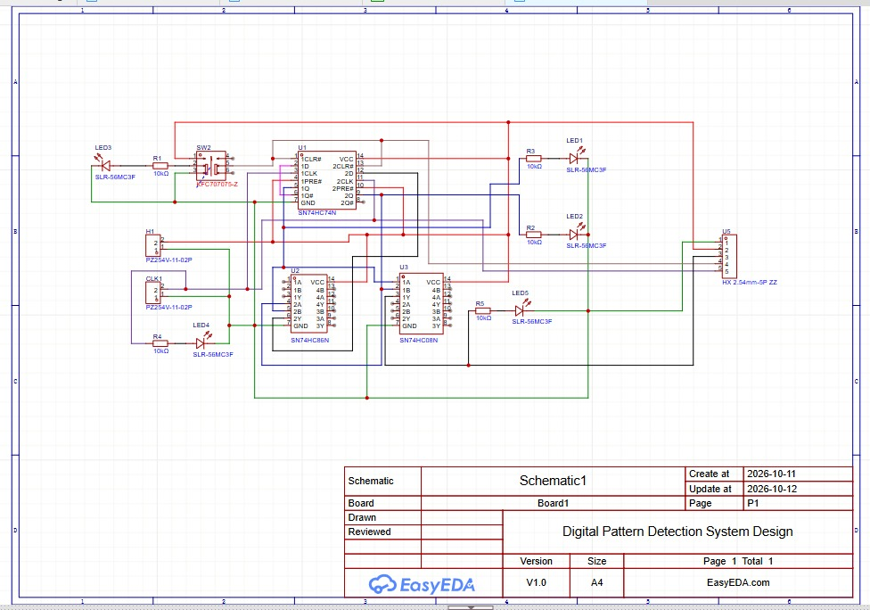</a></td><td><a href="assets/easyeda/schematic-2.jpeg">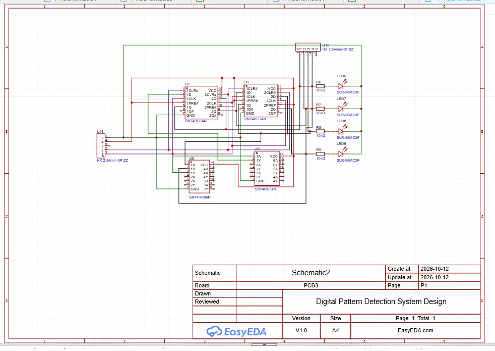</a></td></tr>
<tr><th>Sheet 3</th><th>Sheet 4</th></tr>
<tr><td><a href="assets/easyeda/schematic-3.jpeg">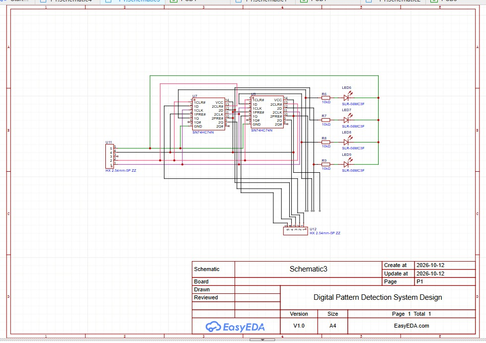</a></td><td><a href="assets/easyeda/schematic-4.jpeg">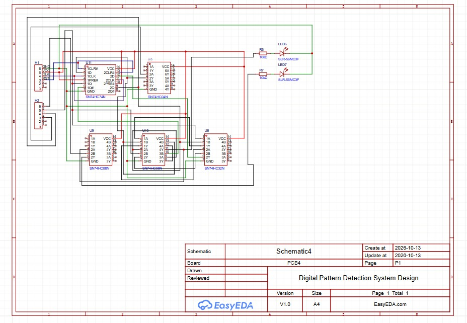</a></td></tr>
<tr><th>PCB layout view 1</th><th>PCB layout view 2</th></tr>
<tr><td><a href="assets/easyeda/pcb-layout-1.jpeg">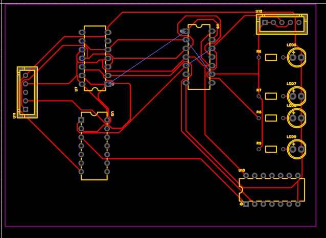</a></td><td><a href="assets/easyeda/pcb-layout-2.jpeg">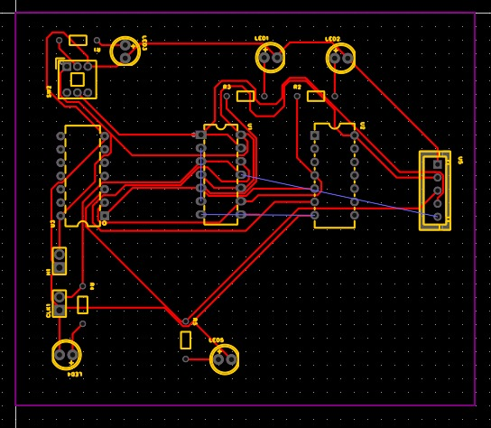</a></td></tr>
</table>

## How the system works

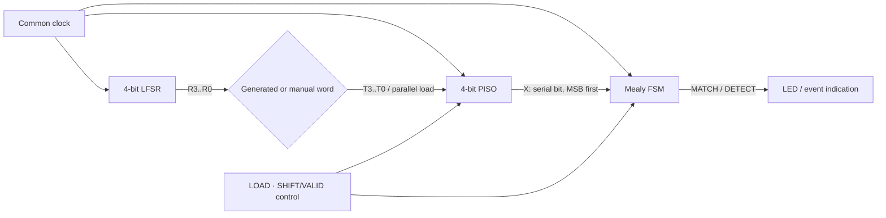

1. A four-bit LFSR produces a pseudo-random word. The report also describes a manual test-word selection path.
2. `LOAD` captures the selected word into the PISO register on a rising clock edge.
3. Four valid clock edges present the bits most significant bit first. For `0010`, the serial order is `0, 0, 1, 0`.
4. The FSM tracks the longest useful prefix of `0010` seen so far. A match occurs in `S3` when the input is `0`.
5. The output stage makes a detection event visible. Consult the schematic before assuming whether a particular LED is a pulse, a stored flag, or an intermediate-state indicator.

### Detector states

| State | Encoding | Meaning | Input `0` | Input `1` |
|---|---:|---|---|---|
| `S0` | `00` | No useful prefix | `S1`, no match | `S0`, no match |
| `S1` | `01` | Last bit was `0` | `S2`, no match | `S0`, no match |
| `S2` | `10` | Last bits were `00` | `S2`, no match | `S3`, no match |
| `S3` | `11` | Last bits were `001` | `S1`, **match** | `S0`, no match |

The table above transcribes the report's state transition table. Its `S3 --0--> S1` transition preserves the trailing `0` as the beginning of a possible next match, so this **table is overlap-aware**. For example, `0010010` contains matches ending at bit positions 4 and 7 (counting from 1).

### Boolean logic from the transition table

Let `Q1Q0` be the present state, `X` the serial input, and `¬` / `·` / `+` mean NOT / AND / OR. For the enabled FSM:

```text
D1    = Q1·¬Q0 + ¬Q1·Q0·¬X
D0    = ¬Q1·¬Q0·¬X + Q1·¬Q0·X + Q1·Q0·¬X
MATCH = Q1·Q0·¬X
```

`D1` and `MATCH` agree with the report's listed equations. The `D0` equation here includes the term `Q1·Q0·¬X`, required by its transition table for `S3` with `X=0`. The printed `D0` equation omits that term. These are **reference equations derived from the table**, not a claim that the supplied Proteus wiring already implements the correction. See [design notes](docs/design-notes.md#report-consistency-and-design-limits).

## Open and inspect

1. Clone or download this repository, preserving the `proteus/` directory structure.
2. Open `proteus/PROJECT.XML` in a compatible Proteus Design Suite installation. If necessary, open `proteus/ROOT.DSN` as the schematic.
3. Confirm the power rails, clock source, reset/initialization and simulation libraries on your installation.
4. Run the simulation and observe the source word, serial bit `X`, state bits, and match output. Compare them with the state table above.

Proteus is proprietary software and is not bundled here. This repository does not include a headless Proteus test run or hardware measurements.

## Physical prototype

These photographs document the breadboard assembly and illuminated indicator LEDs. They show the build, but a still photograph alone does not prove the exact serial input sequence or detection timing.

<table>
<tr><td><a href="assets/hardware/breadboard-overview.png">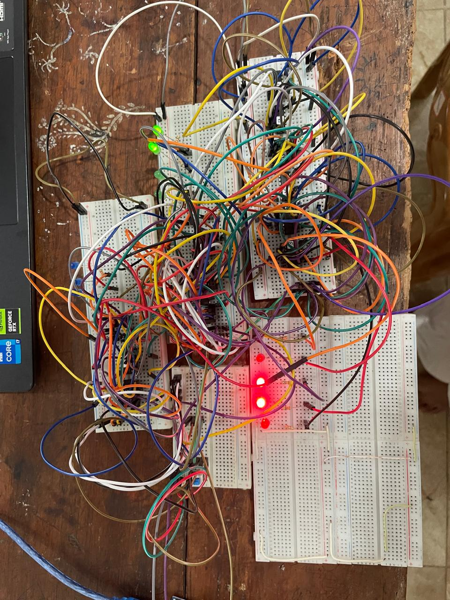</a></td><td><a href="assets/hardware/red-led-closeup.png">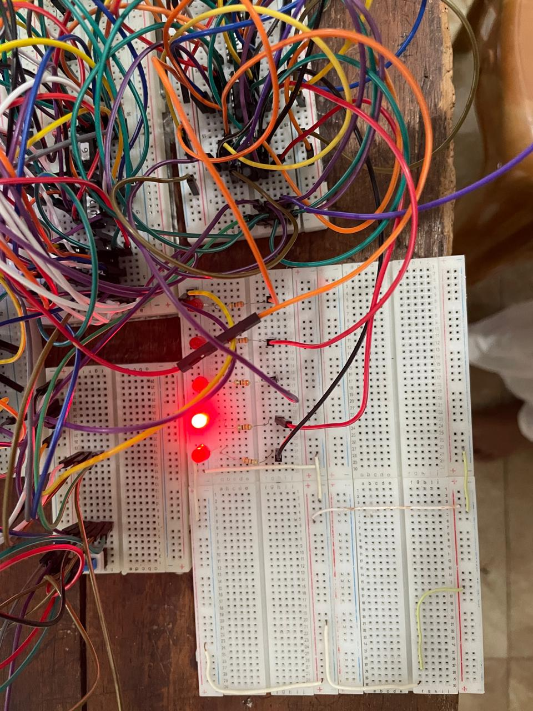</a></td><td><a href="assets/hardware/blue-green-led-closeup.png">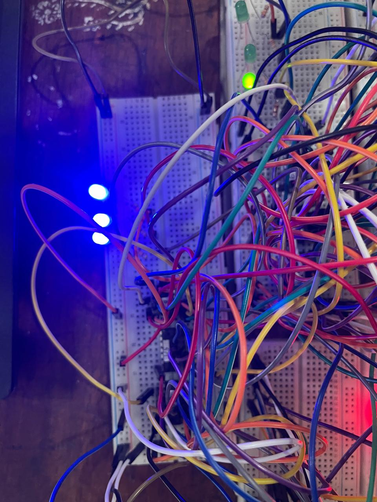</a></td></tr>
</table>

## Documentation and evidence

- [Detailed design notes](docs/design-notes.md): signals, timing, state logic, implementation and report discrepancies.
- [Original group report](docs/IE3004_Group_10_DSD.pdf): architecture, K-maps, Proteus screenshots, EasyEDA layout images, waveform and physical-build images.
- [Proteus source](proteus/ROOT.DSN): editable schematic supplied in the original project ZIP.
- [Full schematic screenshot](assets/proteus-schematic.png): quick visual overview; zoom into the Proteus source for net-level review.
- [EasyEDA screenshots](assets/easyeda/): schematic sheets and PCB layout views supplied after the initial project archive.
- [Breadboard photographs](assets/hardware/): physical assembly and LED close-ups.
- [Demonstration videos](https://drive.google.com/drive/folders/1mSg9VXbnH145L3aklPPoBSd-jyJw_CjK): external folder linked in the group report; availability has not been checked here.

## Team and attribution

**IE3004 · Digital System Design · Group 10**

- K. G. U. K. Iranthaka · IT24103475
- P. K. S. Sanilka · IT24103564
- M. I. N. Aara · IT24103483

The supplied report is the source for the project description and team details. Original report and Proteus files remain attributed to the group. No open-source license was provided, so repository use and redistribution rights should be confirmed with the team before public publication.
